# Zenith: product and technical audit

September 12, 2026 · current code, a running local application, and an isolated copy of the existing demo database.

## Verdict

**Zenith has a useful constrained-planning foundation, but the current product is an administration and dispatch console. It does not yet express a public commons for pursuing the owner's endstate.**

The gap is structural: the main objects are workers, work orders, inventories, and assignments. There is no primary place for a desired condition, evidence quality, competing transition pathways, affected parties, consent, dissent, or institutional revision. Redesigning the current pages around the same workflow would preserve that mismatch.

Recommended direction: [a public transition-planning workbench](../../product_vision.md), demonstrated through one synthetic healthy-homes project. See the [rebuild sequence](../../roadmap.md) and [UI specification](../../planner_ux_plan.md).

## Scope and evidence

The repository started clean. The audit mapped 138 tracked files, 13 web page modules (including the organization redirect), 32 API application Python files, shared schemas, the planner package, 15 migrations, all nine Python test files, seed/bootstrap scripts, dependencies, and the documentation. The critical planning and mutation paths received detailed source review; this is not a claim that every statement or possible CRUD combination was exhaustively verified.

The in-app browser visited all 12 primary screens: entry, overview, run, review, reports, work, people, capabilities, rules, materials, equipment, and structure. It exercised organization selection, horizon selection, plan generation, draft review, comparison, and approval. It inspected a 390 × 844 mobile viewport as well as desktop layouts. Accepted screenshots were saved and reopened; loading/transition captures were replaced.

The existing SQLite database was copied with SQLite's backup API to `/tmp/zenith-audit-20260912/audit.db`; runtime mutations affected that copy. The original `zenith_local.db` was not used as the running API database. The copy was already at migration `20260305_0015`.

The audited dataset contains MetroGrid Utility Operations and Harbor Transit Field Operations. The main captured organization has eight workers, 18 work orders, three locations, and a seeded April planning horizon. Its work titles are generic fixture content. These are observations of the existing demo, distinct from the proposed healthy-homes fixture.

## Verification

| Check | Result | Evidence / limit |
| --- | --- | --- |
| Python tests | **42 passed** | [pytest output](pytest.log); includes planner, API workflows, and migration smoke test |
| Python lint | **Pass** | [Ruff output](python-lint.log) |
| Web production build, before | **Fail** | TypeScript 6 rejects deprecated `baseUrl` without an explicit compatibility setting |
| Web production build, after | **Pass** | Removed redundant `baseUrl`; existing `@/*` mapping is already relative. [Build output](web-build.log) |
| Web typecheck, after | **Pass** | `bun run typecheck:web` |
| Web lint | **Blocked by toolchain incompatibility** | ESLint 10.10.0 / React plugin 7.37.5 crashes with `contextOrFilename.getFilename is not a function`; [output](web-lint.log) |
| Development server | **Unstable in this environment** | Repeated Watchpack `EMFILE` errors and development-directory restart messages; production server used for the visual audit |
| Local API and organization access | **Reachable without authentication** | Organization list returned 200; source dependencies have no authenticated principal |
| Plan creation | **Works with a workaround** | Selecting the saved horizon's auto-filled dates fails; removing the horizon link allows a draft |
| Approval | **Works without authenticated identity** | Local draft became approved by the editable `local-planner` name |
| Publication / field execution in browser | **Unverified** | Automatic approval review rejected publishing and reservation creation; no indirect retry was attempted |
| PostgreSQL / deployed app | **Not tested** | SQLite and local production web server only |

The existing API suite includes publication, reservation, reassignment, cancellation, dispatch, and execution cases. Passing those tests does not replace browser publication or a production concurrency/security review. No claim of full accessibility compliance, security hardening, or model validity is made.

## Six audited user tasks

| Step | Task | Health | Captures |
| --- | --- | --- | --- |
| 1 | Enter and understand the product | **Purpose mismatch** | 01–02 |
| 2 | Inspect needs, capabilities, resources, and rules | **Functional administration; high friction** | 07–13 |
| 3 | Configure and generate a plan | **Default horizon flow fails** | 03–04 |
| 4 | Review, compare, and approve | **Misleading comparison; weak authority model** | 05, 14 |
| 5 | Inspect results of execution | **Loads; empty demo and unverified live publication** | 06 |
| 6 | Use the interface on a narrow screen | **Reflows, but navigation and repetition dominate** | 15 |

## Highest-impact findings

### F01 — Product purpose and audience are unresolved in the implemented flow

**Priority: direction blocker. Evidence: steps 1–6 and the current domain/schema.**

Entry asks visitors to choose or create an organization; the next action is to fix an operational draft. The model has no public project brief, desired condition, baseline evidence, intervention effects, or record of contested public reasoning. “Rules” means service-level targets. “People” means capacity to assign.

**Action:** introduce a public project and a baseline → pathways → consequences → decision → observation loop. Preserve the scheduling package as bounded feasibility support. Express expanding capacity, reducing future need, and revisable institutions in the model rather than adding aspirational copy to an allocation console.

### F02 — Identity and public authority are not enforced

**Priority: public-release blocker. Evidence: step 4, unauthenticated API reads, and source.**

The API's shared dependency only supplies a database session. `approve_plan_run` accepts `actor_name` and stores it as the approver. The browser accepted approval as `local-planner` without login. Queue-specific permission checks resolve a user from a caller-supplied ID or name; that lookup does not authenticate the caller. CRUD endpoints, including identity management, are not generally protected by an authenticated principal.

Sources: [dependencies](../../../apps/api/app/api/dependencies.py), [planning service](../../../apps/api/app/services/planning_service.py) (`approve_plan_run`, `_resolve_dispatch_actor_user`, `_require_dispatch_queue_apply_permissions`), [identity routes/services](../../../apps/api/app/services/identity_service.py).

**Action:** an anonymous demo needs isolated synthetic state and a narrow public API. Real shared edits require server-derived identity and authorization. Public decision legitimacy additionally needs an explicit process, affected-party rights, accountable stewardship, and revision rules; an actor picker cannot supply those.

### F03 — Scenarios do not preserve an alternative world

**Priority: P1, model integrity. Evidence: schemas and run creation/rerun paths.**

`OrganizationPlanningRequest` stores IDs, status filters, horizon, and dates. `create_plan_run` constructs resolved facts from the database, solves them, then persists the selection request and result. It does not retain the complete resolved input facts, objective configuration, or model version. `rerun_plan_run` applies the old selectors to current data. Scenario cloning therefore cannot guarantee a reproducible alternative.

Sources: [planning schemas](../../../packages/schemas/src/zenith_schemas/planning.py) (`OrganizationPlanningRequest`, `PlanRunRead`); [planning service](../../../apps/api/app/services/planning_service.py) (lines 2166 onward; `rerun_plan_run`).

**Action:** immutable baseline and pathway versions; persist resolved inputs, input hash, configuration, engine version, and result metadata. A live-data refresh should create a new baseline, not silently change the meaning of an old branch.

### F04 — Selecting a saved horizon produces invalid dates

**Priority: P1, broken primary flow. Evidence: step 3 and [probe results](probe-results.json).**

Reproduction: select **Seeded Ops Week** on Run, accept its auto-filled dates, click **Run plan**. The API returns `window_end cannot be later than the selected planning horizon end.`

The SQLite response represents the end as `2026-04-12T18:00:00`, without an offset. The browser interprets it as local time; converting the form back to an ISO timestamp produces 22:00 UTC in New York. The server's UTC normalization interprets the saved naive value as 18:00 UTC. The round-trip shifts the instant by four hours. Clearing dates while keeping the selected horizon repopulates them, so it does not repair the flow.

Sources: [format helpers](../../../apps/web/lib/format.ts), [horizon model](../../../apps/api/app/db/models/planning.py), [planning service](../../../apps/api/app/services/planning_service.py) (`_as_utc`, `_resolve_planning_window`), [run page](../../../apps/web/app/orgs/[organizationId]/planning/run/page.tsx).

**Action:** enforce offset-bearing UTC serialization at the API boundary and explicit display timezones. Add round-trip checks across SQLite, PostgreSQL, DST, and browser timezone differences. Do not fix this by selectively shifting one form.

### F05 — Removing work from scope is displayed as recovering it

**Priority: P1, misleading decision evidence. Evidence: step 4, capture 14, and probes.**

After the horizon workaround, the baseline and candidate both have three assigned work orders. Unassigned work falls from 15 to 14 because one work order leaves the effective scope. The UI reports **Recovered work: 1** and **Previously blocked work orders now cleared**. The removed work order is not assigned in the candidate.

`_unassigned_changes` reports an unassigned item absent from the candidate as `removed`; the results page counts every such item as recovered. Neither verifies that the candidate serves that need.

Sources: [planning service](../../../apps/api/app/services/planning_service.py) (line 4142); [results page](../../../apps/web/app/orgs/[organizationId]/planning/results/page.tsx) (line 1032).

**Action:** preserve a shared baseline/scope for comparison. Report served, still unmet, added to scope, removed from scope, and unknown separately. Only count an item as recovered when it moves into candidate assignments.

### F06 — Work windows conflate release time, deadline, and duration

**Priority: P1, feasibility integrity. Evidence: planner source and reproducible probe.**

`_work_interval` uses `requested_start_at` and `due_at` directly as the occupied interval. The solver chooses assignments, not their start times. If only a due date exists, the interval starts and ends at that date while `_planned_duration_minutes` charges at least 60 minutes. A direct probe assigns two due-only jobs to one person at the same instant, each with a zero-length output interval.

Source: [planner](../../../services/planner/src/zenith_planner/planner.py) (lines 810–821 and overlap constraints). Reproduce with [kernel probes](kernel_probes.py).

**Action:** separate positive duration, earliest start, and deadline. Either explicitly require fixed valid intervals in this kernel or implement real interval scheduling. Keep the limitation visible in the transition demo's short-term feasibility adapter.

### F07 — The objective rewards unnecessary staffing

**Priority: P1, allocation quality. Evidence: [probe results](probe-results.json).**

One work order requires one worker and three skills. Two workers each independently satisfy all three. The planner assigns both. Each additional matching worker earns 300 skill points against a 250 staffing penalty; a minimum-headcount constraint and that positive marginal reward allow redundant staffing.

Source: [planner](../../../services/planner/src/zenith_planner/planner.py) (objective constants and assignment terms near lines 25–155). [Kernel probes](kernel_probes.py) reproduce the case.

**Action:** satisfy required coverage first, then minimize unnecessary work/crew size with a documented objective. Preserve complementary-skill crews; simply enforcing exact headcount could break those cases. Test both kinds of crew.

### F08 — Informational summaries become exceptions

**Priority: P2, trust and signal quality. Evidence: steps 1 and 4.**

The planner appends “Optimization planner created …” to `issues` on successful completion. `classifyIssue` recognizes the older “draft planner created” string as a summary. The new string falls into another issue group; issue totals include it, and comparison labels a changed completion summary a new or resolved warning. The original overview shows 16 exceptions for 15 unassigned work orders plus this summary.

Sources: [planner](../../../services/planner/src/zenith_planner/planner.py) (line 391); [review helpers](../../../apps/web/lib/planner-review.ts) (line 171); [overview](../../../apps/web/app/orgs/[organizationId]/overview/page.tsx).

**Action:** typed information, warning, error, and exclusion records. Avoid classifying domain semantics by English substrings.

### F09 — Resource availability is not consent or capacity transformation

**Priority: product/model gap. Evidence: schemas and planner.**

`WorkerFact.available` defaults to true and an empty availability-window list is treated as available. The domain models employment status and skill availability, but not offered participation, consent conditions, declining an assignment, institutional authority, investment lead times, or future changes in productive capacity.

**Action:** for the demo, model explicit aggregate capability offers and their assumptions. Describe investments as time-dependent changes with costs, dependencies, and uncertain effects. Do not relabel current employment records as voluntary public participation.

### F10 — Main screens allocate space to setup instead of understanding

**Priority: P2, UX structure. Evidence: captures 01–13.**

Repeated sidebar/topbar navigation and organization metadata use space without adding context. Overview gives a very large heading and repeated calls to review exceptions. Input screens permanently show create forms beside narrow tables, wrapping titles and making status/resource columns require local horizontal scrolling. Review places lifecycle, assignments, overrides, execution, comparison, tables, queues, recovery, history, and issues on one long page.

**Action:** three coherent project views; comparison as the primary surface; contextual evidence/details; separate authoring from reading. Keep meaningful density and reduce repeated containers, badges, and oversized headers.

### F11 — Keyboard access and state communication need repair

**Priority: P1 for essential keyboard interactions; P2 for other semantics. Evidence: step 2 source/DOM, step 3 error, and step 6 DOM.**

Worker and work-order selection uses `<tr onClick>` without a focusable link/button or keyboard handler. Primary/current flow links have no `aria-current`. Run errors are ordinary paragraphs rather than announced error regions. The existing crew selector requires modifier-key multi-selection. There is no shell skip link. These findings are source/DOM-supported, not inferred solely from pixels.

Strengths: many forms wrap controls in labels; tables use table/header semantics; icon-only sidebar toggle has an accessible name; inputs have explicit focus styling; CSS honors reduced motion.

**Action:** semantic row actions, focus-visible controls, current-page semantics, skip navigation, announced errors/results, and an accessible selection pattern. Complete keyboard and assistive-technology testing after the structure changes. Contrast ratios and 200% zoom were not measured in this audit.

### F12 — Narrow layout reflows, but its hierarchy remains inefficient

**Priority: P2. Evidence: capture 15 and DOM widths.**

At 390px, the document fits the viewport (`clientWidth` and `scrollWidth` both 390). Navigation becomes a clipped horizontal strip, followed by a second navigation row and API/organization controls. The repeated review actions dominate the first screen; the useful planning facts remain lower down.

**Action:** compact project header and local view selector, with one clear action. A mobile comparison should keep a baseline and selected alternative understandable without the desktop control density.

### F13 — Architecture and dependencies have accumulated competing responsibilities

**Priority: P2, maintainability. Evidence: source inventory and toolchain checks.**

The results page is 4,412 lines; `planning_service.py` is 5,184 lines with 148 functions. That service combines input projection, solving orchestration, CRUD, approval, publication, reservations, dispatch, events, comparisons, and reporting. Python schemas and the 915-line handwritten TypeScript contract duplicate domain definitions. Root and web package manifests duplicate dependencies. Documentation prescribes Redis/background workers, while planning runs execute synchronously in the request path. `generate_stub_plan` actually invokes OR-Tools; `planner_mode` is declared but not used to select it.

**Action:** first remove dispatch from the target demo scope. Then split by actual responsibility—baseline projection, evaluation, comparison, and decision records—and generate client contracts from the API schema. Keep a modular monolith; introduce background processing only when measured latency/concurrency requires it. Reconcile the lint toolchain rather than suppressing the failure.

### F14 — The demo and documentation overstate completion

**Priority: P2. Evidence: all screens and repository documents.**

The captured demo uses generic “Seeded work order” names and an old April horizon. Actuals loads nine separate empty sections, including “No bottlenecks” despite there being no published runs. Historical documents call some foundation phases functionally complete while listing authentication as missing; planner README still describes a phase-zero stub. The repository has no `.github` workflow directory even though docs discuss CI. The landing page's API docs link `/api/v1/docs` returns 404 with the current proxy; FastAPI serves its docs at `/docs`.

**Action:** a resettable, understandable synthetic story with expected outcomes; distinguish missing data from favorable outcomes; update current evidence separately from planned capability. The new product documents now make this distinction and archive the prior direction.

## Screenshot walkthrough

### Step 1 — Enter and understand: purpose mismatch

**01 · Entry.** Organization creation and environment diagnostics dominate. Existing organizations are easy to enter, but the public purpose is absent.

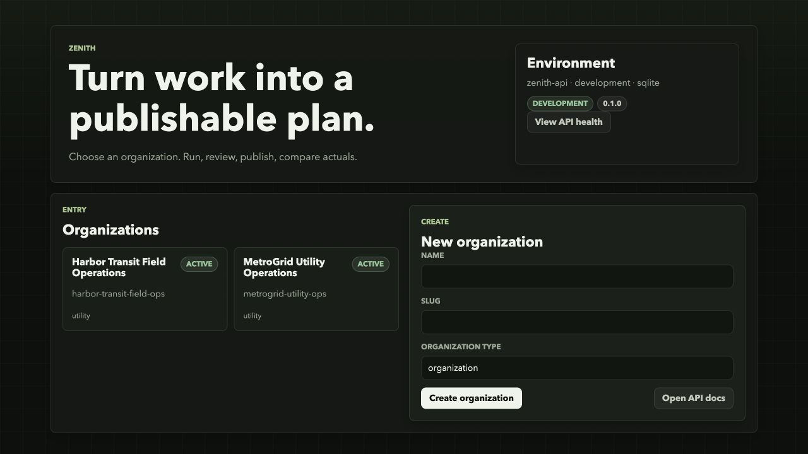

**02 · Overview.** The next operational action is prominent; its oversized repetition and raw exception count obscure meaning.

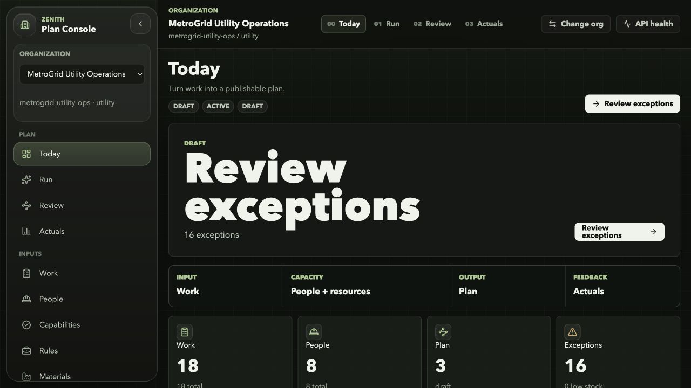

### Step 2 — Inspect planning inputs: administration works, public reasoning is absent

**07 · Work.** Search and status filter are present. Narrow click-only rows contain generic fixture names; the create form permanently consumes half the workspace.

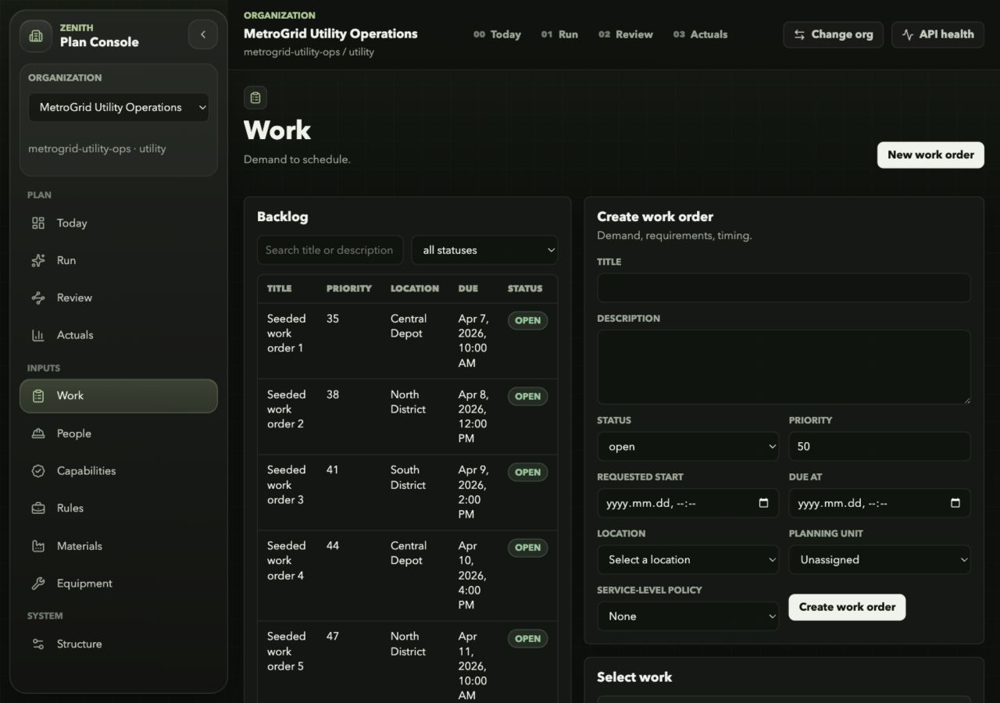

**08 · People.** Structured capability inputs are useful to the kernel. Employment-oriented terminology and a mouse-only row-selection pattern limit the target public experience.

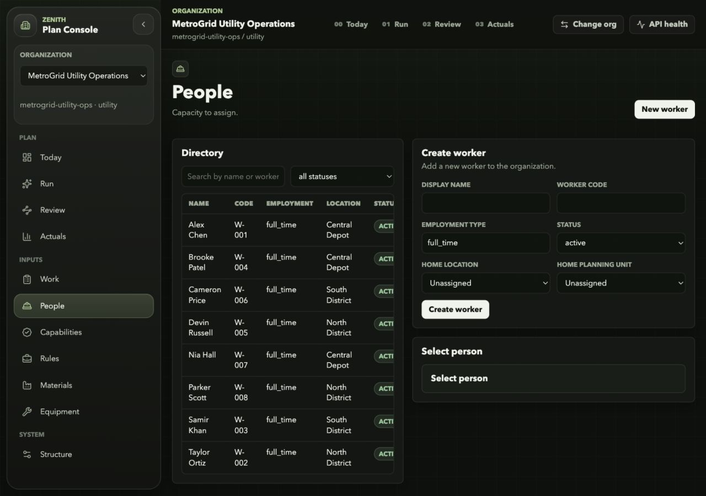

**09 · Capabilities.** Skills and credentials are legible, but two catalog editors are setup machinery rather than evidence about a proposed future.

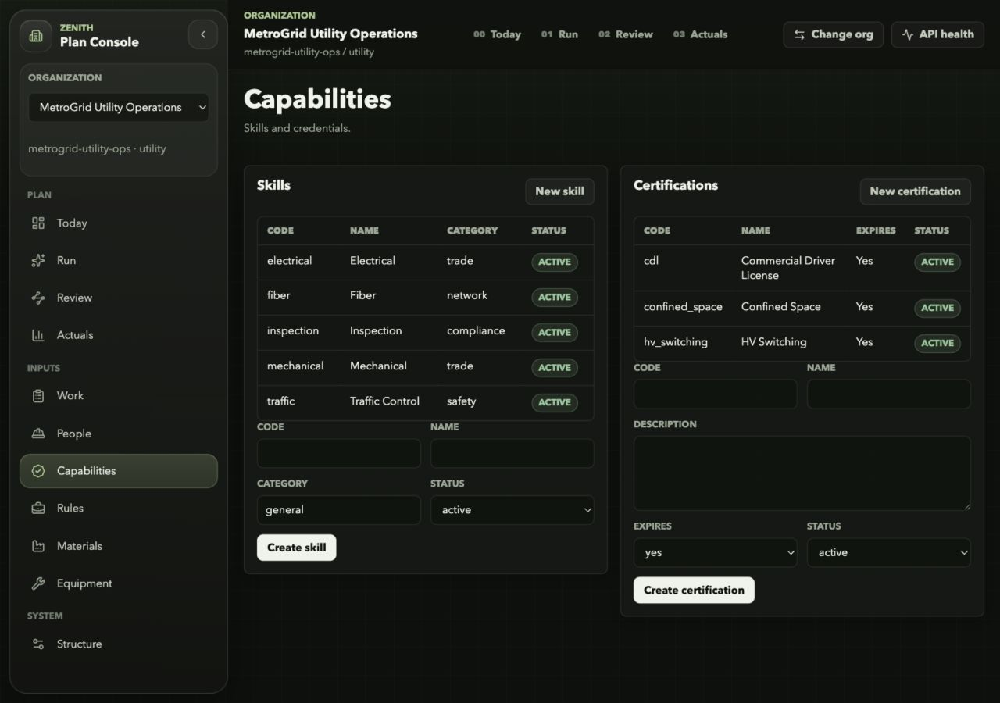

**10 · Rules.** Service-level policies have names and targets. They do not express public protections, consent, or how competing objectives are chosen.

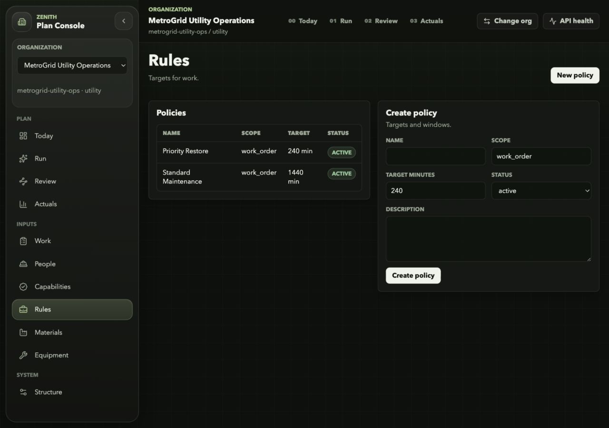

**11 · Materials.** Location-aware stock is useful. The narrow inventory table hides important quantities behind horizontal scrolling.

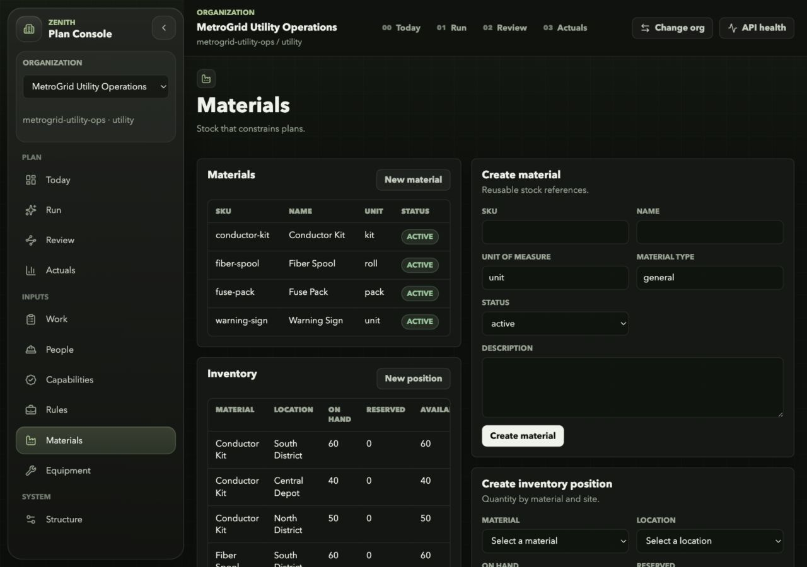

**12 · Equipment.** Concrete tool types and units support feasibility. Creating types and units dominates the view before the visitor has a project question.

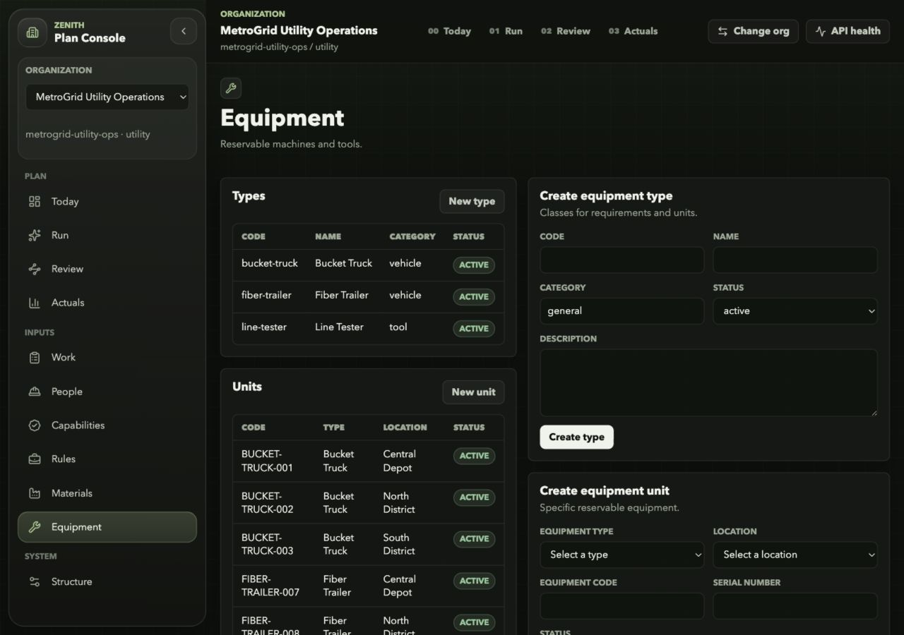

**13 · Structure.** Organization, sites, and units are editable. This is reference administration and should sit outside the public demonstration's main flow.

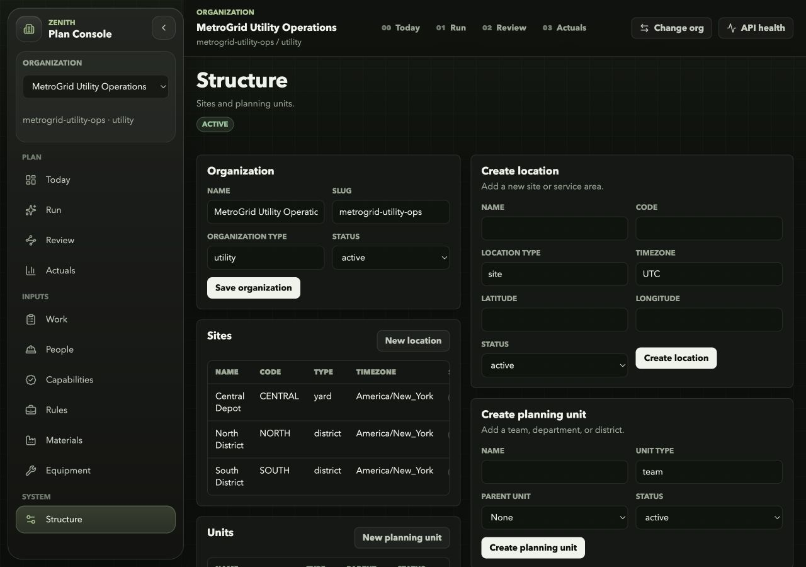

### Step 3 — Generate: default horizon workflow fails

**03 · Run setup.** Scope, horizons, and scenario authoring compete on a long page. There is no explicit objective or alternative pathway to compare.

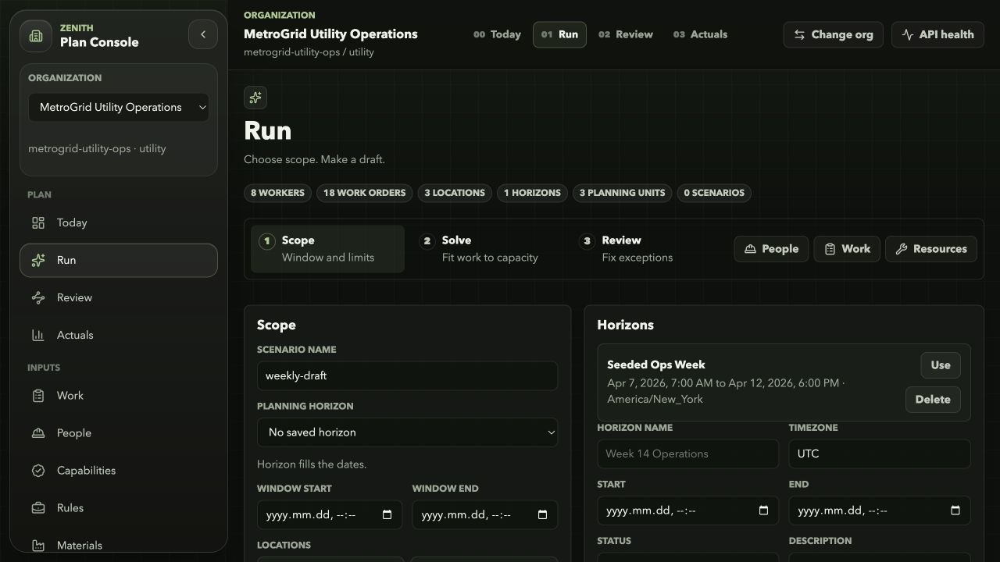

**04 · Auto-filled horizon error.** A normal selection produces a raw `window_end` error. The error is above the submit button's viewport and is not announced as an alert.

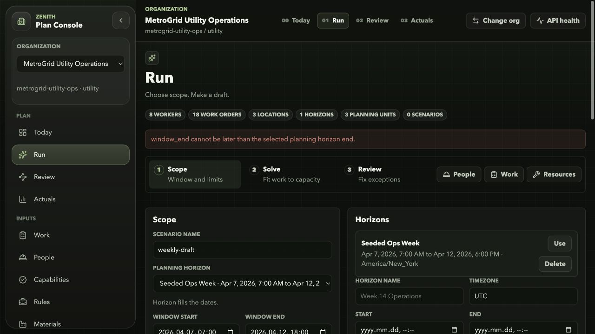

### Step 4 — Review and compare: misleading evidence

**05 · Review.** A persisted result is available, but computation completion, review state, and publication state are repeated as badges. “0 locations” describes an empty filter that actually means all locations.

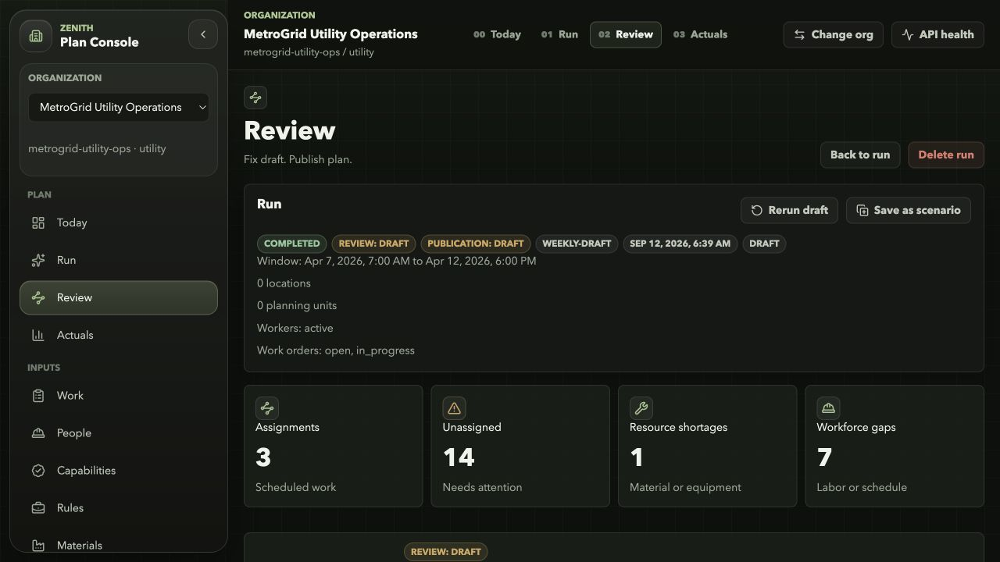

**14 · Comparison.** Both runs still have three assignments; the UI claims one recovered work order. Probes confirm that it was removed from scope, not assigned.

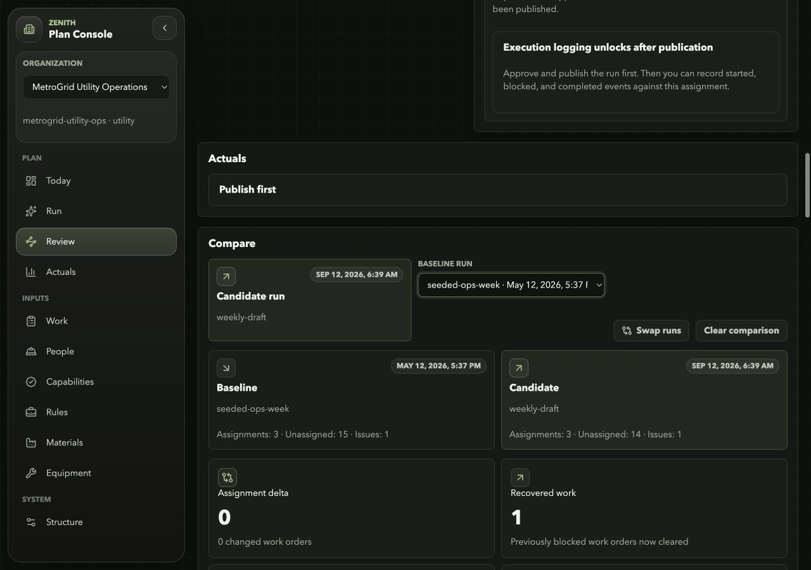

Approval was exercised in the isolated copy and accepted the editable actor name. Publication was rejected by automatic approval review, so reservation creation and field execution were not verified through the browser.

### Step 5 — Inspect outcomes: no execution evidence in the captured data

**06 · Actuals.** Filters and reports load, but all values are empty/zero. “No bottlenecks” should not imply successful operations when no published runs exist. The API regression suite covers report data; this browser capture establishes the empty state only.

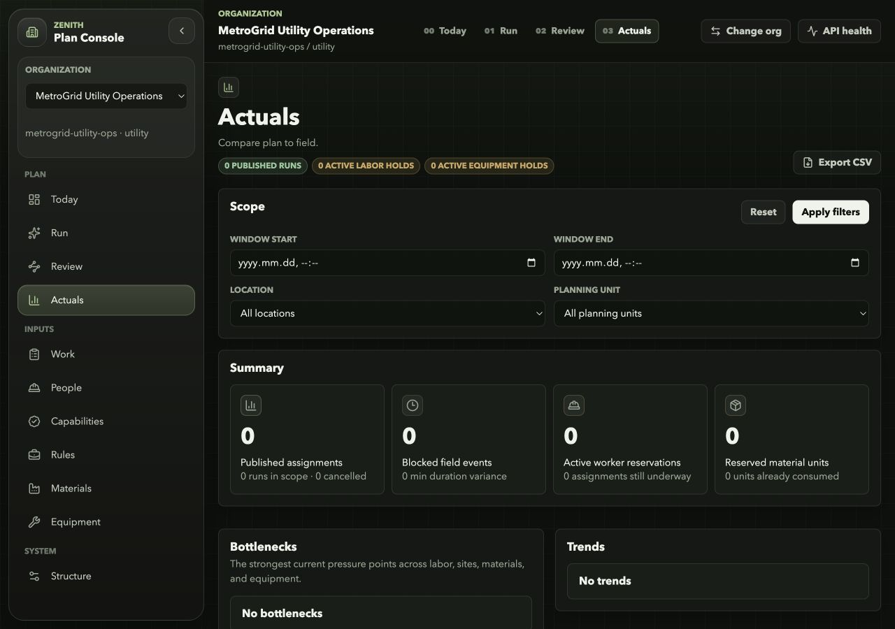

### Step 6 — Narrow screen: usable reflow, excessive repeated navigation

**15 · Mobile overview, 390 × 844.** No document-level horizontal overflow was observed. The clipped navigation strip, repeated navigation, and repeated review action still dominate.

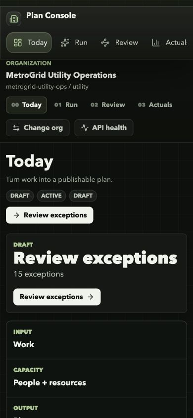

## Changes made during this audit

- Removed the redundant `baseUrl` compiler option; the production build and standalone typecheck pass. Next regenerated its normal type-reference file.
- Replaced the product vision, roadmap, and UI plan; retained their prior versions in the documentation archive.
- Preserved the owner's endstate statement verbatim and aligned the README/documentation entry points.
- Added this evidence report, 15 accepted screenshots, verification logs, and minimal model probes.

No production deployment, replacement UI, database migration, or deletion of existing operational records was performed. The app rebuild is the next implementation stage. The listed model, timezone, identity, comparison, and lint defects remain open; the build configuration fix is the sole application change in this audit.
