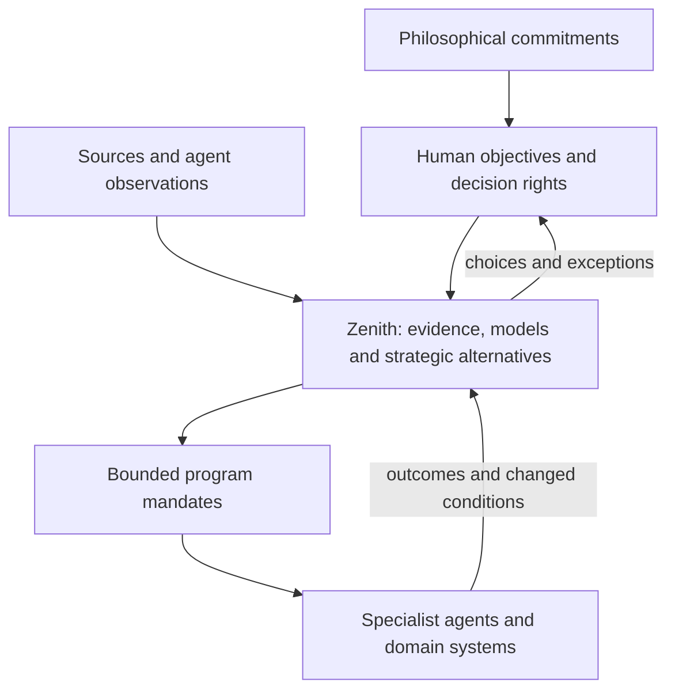

# Zenith: strategic coordination for humans and agents

Owner-directed scope correction · October 4, 2026. This supersedes the maintenance-operator positioning. Existing products are references and competitors; their coverage does not limit Zenith's ambition. [Endstate](endstate.md) provides the philosophical foundation. [Roadmap](roadmap.md) defines the next demonstrable system; [implementation contract](mvp.md) describes what actually exists today.

## Objective

**Help humans and agents form a shared understanding of a changing world, choose coherent strategies under explicit values and constraints, coordinate their execution, and revise them from evidence.**

Zenith is the strategic coordination layer. Human decision makers use it to choose ends, compare consequential tradeoffs, authorize programs and review exceptions. Agents use the same system to contribute evidence, propose interventions, negotiate dependencies and resources, carry out bounded mandates and report outcomes.

Its central questions are: **what are we trying to make true; what do we believe is happening; which strategy moves us toward our objectives; what must each participant commit to; and what should cause us to change course?**

The intended human users are leaders and stewards of organizations, institutions, research programs and networks. The machine users are specialist agents and their coordinating systems. Detailed work can remain in domain systems and agent workflows. Zenith must make their consequences and commitments understandable at the level where strategic choices belong.

Scope is deliberately broad. It can coordinate a company's transformation, an infrastructure program, a regional transition or a small team's initiative. A small demonstration should exercise the strategic hierarchy; it should not redefine the product as a maintenance scheduler. Domain models can differ while the coordination contracts remain shared.

## Philosophy as part of the system

The owner's definition of endstate supplies an orientation toward durable sentient flourishing, reduced involuntary suffering and domination, ecological continuity, truth, competence, autonomy and option value. These commitments shape the decision model and authority system. They are not a decorative mission statement or an automatically computed universal utility function.

| Foundation | Required product behavior |
| --- | --- |
| Explicit ends | Objectives identify desired conditions, affected parties, time horizons and measures. Conflicting ends remain visible. |
| Truth and epistemic humility | Claims retain provenance, dates, scope and epistemic status. Observations, assumptions, inferences and forecasts remain distinguishable. Disputed claims coexist rather than being silently averaged into truth. |
| Agency and non-domination | Authority is scoped, attributable, revocable and checked at execution. A proposed outcome does not authorize its means. Participant conditions and refusals affect feasibility. |
| Pluralism | Compare non-dominated strategies across separate consequence dimensions. Show who benefits, who carries burdens and what is omitted. Deliberate human judgment resolves consequential value conflicts. |
| Option value | Expose reversibility, irreversible commitments and the consequences of waiting. A short-term gain can reduce future freedom. |
| Recursive improvement | Keep the original belief, prediction, decision and mandate; compare observations against them and issue new versions. Updating a plan does not rewrite its past. |
| Broad moral and ecological scope | Include declared affected beings, ecosystems and future generations; distinguish measured impacts, proxies and unknowns. Absence of a measure does not imply absence of an effect. |

Scopes may have distinct legitimate objectives and decision processes. The system must reveal conflicts between them rather than silently replacing local ends with a central preference. Philosophical commitments need an explicit agreed policy representation before they can be enforced by code; prose fields alone are insufficient.

## Seven primitives

The primitives form one versioned coordination model. Evidence records, run manifests, actor identities and source adapters support them without requiring a new human page for every type.

| Primitive | Meaning | Essential contract |
| --- | --- | --- |
| Scope | A decision boundary within a wider system | Parent/relationships, included entities, horizon, accountable authority and inherited/local policy; nesting alone grants no authority |
| Objective | A condition sought within a scope | Beneficiaries, dimensions, targets, horizon, protections, conflicts and review process |
| Claim | A statement about state, mechanism or expectation | Subject, value/unit where applicable, time, scope, source, epistemic status, uncertainty and competing claims |
| Capability | Something a participant can provide or do | Provider, quantity/unit, availability, conditions, existing reservations and resource identity across scopes |
| Intervention | A proposed change to a system | Mechanism, evidence, required capabilities, dependencies, costs, expected effects, risks and reversibility; can compose smaller interventions |
| Mandate | A bounded delegation to a person, agent or institution | Issuer, recipient, objective/intervention references, allowed actions, resource envelope, expiry, exclusions, reporting, escalation and revocation |
| Outcome | A result used for learning and review | Linked input/decision/mandate versions, predicted and observed measures, provenance, deviations and unresolved causal explanations |

A strategy is a compatible portfolio of interventions directed at objectives. A world model is the scoped graph of entities, claims, capabilities, dependencies and commitments. A decision selects or revises a strategy and authorizes specific mandates. These are views and events over the primitives, rather than disconnected stores of narrative.

A durable decision event records its identity/version, accountable authority, selected portfolio, frozen claim/model/run references, authorized mandates, unresolved disagreement and review triggers. Subsequent authorization checks refer to this event and the current policy version. An explanatory paragraph is not a substitute for that reproducible boundary.

Scopes support both containment and overlap: a regional program and an independent institution can share a capability without either owning the other. Cross-scope policy conflicts and authority boundaries must be resolved explicitly. The nesting view is one useful projection of that graph.

Each primitive has a stable identity, version, scope and provenance. Financial, physical, labor and other resources keep distinct units. A capability used by two nested programs still refers to one underlying pool; aggregation must not double-count it. Rollups retain distributions and exclusions, not just an attractive total.

## Human and agent roles

| Human decision makers | Agents and domain systems |
| --- | --- |
| Set objectives, protections and legitimate decision rights | Observe sources and propose evidence-backed state updates |
| Inspect the system and compare strategic portfolios | Run specialist models and return reproducible results |
| Resolve consequential tradeoffs, uncertainty and cross-scope conflicts | Find dependencies, resource conflicts and candidate interventions |
| Authorize resource envelopes and bounded mandates | Execute permitted actions and coordinate within those envelopes |
| Change priorities, revoke authority or redirect programs | Report state, results, failures and exceptions requiring a new decision |

Delegation can be recursive. A program mandate can permit an agent to issue narrower mandates, but never broader authority or a larger resource envelope. Versioned policy checks, action receipts, acknowledgement, idempotency and revocation are part of the coordination contract. The UI and machine API must use the same validation and commitment rules.

Mandate acceptance must check and reserve capacity atomically against the common resource ledger. Two agents cannot both accept a claim on the same available capacity merely because each passed an earlier validation. Reservations have stable identities and explicit release conditions. Revocation releases only unconsumed reservations once stopping or handover is acknowledged; in-flight or completed commitments remain accounted for. Cross-provider reservation protocols require confirmed holds and a defined failure-recovery process before claiming a joint commitment.

Revocation prevents new authorized effects and initiates a defined stop or handover process; it cannot undo completed physical work. In-flight actions and remaining commitments stay visible. A change in objectives or policy does not silently reauthorize an old mandate.

Humans need visibility into consequential choices and exceptions rather than a stream of every agent action. An execution trace remains available for investigation. Agents need structured contracts rather than a UI they must scrape. Neither a language-model recommendation nor a saved document establishes authority.

## The strategic experience

A decision maker should enter a live decision context: a changing situation, a pending strategic choice and the commitments already in force. The interface should support five connected activities:

1. **Understand:** see the system boundary, objectives, relevant relationships, current trajectory, important evidence changes and uncertainties.
2. **Compare:** inspect competing intervention portfolios, their mechanisms, dependencies, resource conflicts, distributions, expected consequences and sensitivity.
3. **Decide:** choose a course, state the unresolved tradeoffs and authorize an explicit envelope of action with review triggers.
4. **Coordinate:** see which mandates are accepted, blocked, conflicting or revoked; inspect the program-level consequences of an execution problem.
5. **Revise:** compare observed outcomes with frozen expectations, reconsider objectives or assumptions and redirect the appropriate scope.

System maps, timelines, dependency paths and consequence comparisons serve these decisions. Metrics appear where they explain a choice. Zooming into a program preserves the strategic context; zooming out exposes effects on the whole. Generic navigation and explanatory prose should not replace the actual relationships and choices.

## Computation and integration

Zenith needs a common coordination core and replaceable domain models. Ingested sources can include databases, documents, sensor streams, financial systems, external research and agent reports. Adapters attach provenance, units, scope, dates and access rules; contradicting observations are retained. Connectors do not make source claims true.

The core resolves dependencies and commitments, validates policy and resource envelopes, evaluates compatible portfolios and detects conditions requiring reconsideration. Specialist models provide the domain-specific causal or forecasting machinery. Their manifests retain resolved input versions, horizon, assumptions, model/configuration version, outputs, solution status and limitations.

Graph analysis, constrained optimization, scenario simulation, sensitivity analysis and experimental outcome evaluation are candidate methods serving particular questions. Do not imply that a graph by itself establishes causality or that agent consensus validates a forecast. A portfolio can be resource-feasible and still rest on weak causal evidence. Report those separately.

The architecture should permit large scope from the beginning: nested decision boundaries, shared resource identities, versioned evidence and bounded delegation. The first runtime can remain small. It must prove the whole coordination loop instead of requiring a world-scale dataset or every future algorithm at once.

## First complete demonstration

Use a synthetic regional transition spanning **energy, housing and workforce development**. The strategic question is how to reduce energy insecurity and improve living conditions while respecting resource, ecological and agency constraints over several years.

Compare three coherent portfolios: retrofit first, enabling energy infrastructure first, and a parallel program coupled with workforce development. Show why each changes the system, where benefits arrive, which shared resources bind and which assumptions determine the ranking. Evidence and effects must be generated or modeled explicitly, not presented as empirical regional forecasts.

Specialist agents contribute source updates and domain evaluations. A coordination agent assembles candidate portfolios. The human chooses objectives and a strategy, then issues bounded program mandates. A delayed energy dependency or changed workforce estimate must alter downstream feasibility, trigger a review and produce a consequential human choice. Local interventions are available as drilldowns; individual repair tickets are not the primary experience.

The same contracts should also run for one smaller scope. The demonstration's completion criterion is a coherent strategy that results in acknowledged, bounded action and traceable review—not a large quantity of synthetic documents. [The roadmap](roadmap.md) gives the implementation and validation gates.

## Relationship to the current app and market

Alder remains a useful historical test fixture for calculations, records and import/export. The application currently has one hardcoded baseline, three variable assumptions and local narrative decisions; it does not implement the world model, agent mandates, shared commitments or high-level portfolio coordination described here. [The implementation contract](mvp.md) is the source of truth for runtime behavior.

[The market research](product-research.md) identifies useful incumbent capabilities. Foundry, asset-management systems and decision platforms can inform the standard Zenith should exceed. Product overlap is acceptable. Success depends on decision quality, coherent integration, usability, trust and useful execution, not on proving that no competitor covers the category.

Evaluation must include both people responsible for strategic choices and machine clients carrying out mandates. Test whether they can explain the objective, evidence, causal dependencies, tradeoffs and authority; whether an input change affects the right scopes; and whether the resulting actions and outcomes remain coherent. Validate actual usefulness as the system matures without reducing its ambition to the first demonstration domain.
