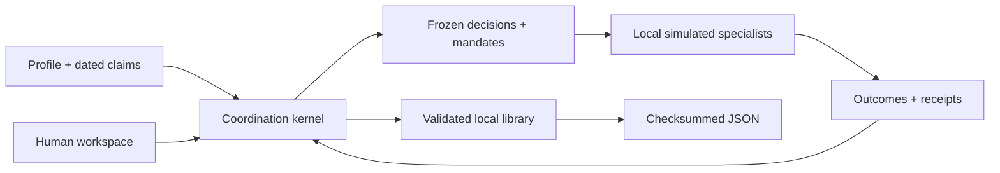

# System architecture

Updated October 4, 2026. The active system is a browser-local strategic coordination kernel and Next.js interface. It realizes a first inspectable loop from evidence to strategy, bounded delegation and outcomes; [product vision](product_vision.md) defines the larger scope.

## Active boundary

The retained Python API, operational solver and database are outside this boundary. The active page mounts `CoordinationApp`; it does not call the earlier `commons` interface or API.

| Module | Responsibility |
| --- | --- |
| `lib/coordination/types.ts` | Shared primitive and state contracts |
| `lib/coordination/core.ts` | Pure validation, evaluation, commands and deterministic replay |
| `lib/coordination/profiles.ts` | Domain fixtures and smaller custom profile construction |
| `lib/coordination/examples.ts` | Worked histories built with kernel commands |
| `lib/coordination/storage.ts` | Library validation, canonical checksum and file envelope |
| `components/coordination/use-library.ts` | Hydrated local storage, synchronization and stale-write guards |
| `components/coordination` | Onboarding, four views, accessible controls and inspections |

Paths in the table are relative to `apps/web`.

## Model and command semantics

A strategy selects declared interventions. Resources are summed per capability and checked against current capacity less retained commitments. Dependencies determine earliest completion. Effects contribute only when completion lies within the projection horizon; missing a target is distinct from breaching a protected limit. No optimizer, probability model or composite ethical score is implemented.

Authorization freezes claim values, evaluation, prior commitments and authority. Mandates freeze resource ceilings, expected effects, dependencies, execution factors and expiry. Acceptance checks explicit agent rights and capability offers; containment alone grants neither.

The simulated runtime advances work in three bounded progress steps. Dependencies must complete before successors advance. A capacity reduction can block execution; stopping retains reservations until acknowledgement. Completed or partially stopped work keeps its consumed resources. Logical simulation ticks are not elapsed planning months.

## Persistence and portability

A version-two `Library` contains independent world workspaces and an active identity. Browser state uses `zenith.coordination.v2`; replacement imports retain a raw previous copy. Earlier version-one keys remain untouched.

Exports contain the complete library in a canonical SHA-256 envelope. Import checks file shape and size, validates contracts, reproduces frozen evaluations and replays the event trace. The checksum detects modification; it does not prove authorship, legitimacy or trust in evidence.

## Production boundary

This implementation has no remote connectors, live agent provider, authenticated decision makers, server database, shared reservations or signed cross-institutional commitments. Independent new instances restart an example; they are not new claims on a shared real-world budget.

The former architecture specification is retained [unchanged in the archive](archive/2026-10-04/system_architecture.md).
