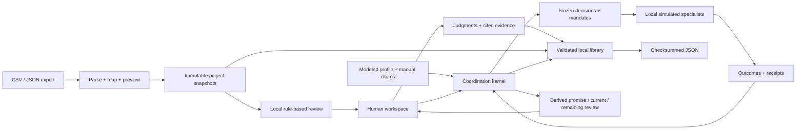

# System architecture

updated November 2, 2026. the active system is a browser-local strategic coordination kernel and Next.js interface. real project exports feed source-backed human review; modeled worlds support strategy, bounded synthetic delegation, outcomes and reconsideration. [product vision](product_vision.md) defines the larger scope.

## Active boundary

The retained Python API, operational solver and database are outside this boundary. The active page mounts `CoordinationApp`; it does not call the earlier `commons` interface or API.

| Module | Responsibility |
| --- | --- |
| `lib/coordination/types.ts` | Shared primitive and state contracts |
| `lib/coordination/core.ts` | Pure validation, evaluation, dependency closure, append-only strategy commands, delegation and deterministic replay |
| `lib/coordination/project-data.ts` | CSV/JSON parsing, column mapping, source snapshots, normalization and provenance validation |
| `lib/coordination/project-review.ts` | Local rule-based findings, evidence continuity, source coverage and appended human responses |
| `lib/coordination/insights.ts` | Derived scoped phase, next action and current attention; no stored workflow |
| `lib/coordination/review.ts` | Issued-course reassessment, claim-to-commitment paths, affected stewards and conditional response alternatives |
| `lib/coordination/profiles.ts` | Domain fixtures and smaller custom profile construction |
| `lib/coordination/examples.ts` | Retained completed worked histories built with kernel commands |
| `lib/coordination/episodes.ts` | Active Explore decisions, partial execution and consequential sourced synthetic changes |
| `lib/coordination/storage.ts` | Library validation, canonical checksum and file envelope |
| `components/coordination/use-library.ts` | Hydrated local storage, synchronization and stale-write guards |
| `components/coordination/use-strategy-draft.ts` | Tab-local session drafts for strategy selection, rationale and composer input |
| `components/coordination/strategy-composer.tsx` | Catalogue selection, live preview and stale-save guard |
| `components/coordination/project-import.tsx` | File/paste input, mapping preview, template download and source refresh |
| `components/coordination/project-workspace.tsx` | Attention, Sources, Record and rule/evidence inspection |
| `components/coordination` | Onboarding, four views, accessible controls and inspections |

Paths in the table are relative to `apps/web`.

## Real-project ingestion and review

`parseProjectInput` accepts CSV or a JSON record array/envelope. `suggestProjectMapping` proposes known headers; `buildProjectSnapshot` requires explicit Title and Project mappings, normalizes the supported fields and retains every original cell. source identity, report date and import time are distinct. [the data contract](project-data.md) defines dates, statuses, money units, dependencies, limits and the header-only template.

`createProjectWorkspace` appends a project-mode workspace to the existing library. its profile grants review actions only and contains no fabricated strategic model. `validateWorkspace` verifies that fixed shell, source ordering and record reproduction. simulation commands reject project workspaces; imported records do not become invented objective effects, resource reservations, mandates or outcomes. modeled worlds continue through their original branch.

`reviewProject` is a pure projection of the latest snapshot, recorded responses and review date. local agents group explicit deadline, funding, dependency and requested-decision conditions by project. they do not use an LLM, infer hidden causality, sum unrelated budgets or convert currencies. missing source coverage is a separate derived projection. the UI recomputes on import, refresh and opening, with date checks while open; no remote source polling or closed-browser monitoring is implemented.

`refreshProject` appends a complete new source snapshot, rejecting stale revisions or backward report dates. it retains earlier evidence; missing rows are absence from the current snapshot, not proof of completion. `recordProjectResponse` appends a judgment tied to the reviewed source, date and rule fingerprint. unchanged relevant facts remain reviewed; changed or recurring conditions reopen. validation reproduces each historical response against its cited snapshot. fingerprints support continuity, not authenticity.

Attention, Sources and Record form the real-data interface. decision drafts remain tab-local and evidence-specific; recording a judgment neither edits the imported source nor writes to external systems. history travels in the same local library and checksummed export as modeled worlds.

## Modeled command semantics

a strategy selects declared interventions. `addStrategy` closes unfinished prerequisites, appends a uniquely identified portfolio with optional `authoredRevision`, and emits a `strategy` event containing the complete strategy payload. replay verifies the addition at its command revision before a later decision can use it. strategy creation is a model addition, not authorization; earlier strategies and frozen decisions are not rewritten.

resources are summed per capability and checked against current capacity less retained commitments. dependencies determine earliest completion. Effects contribute only when completion lies within the projection horizon; missing a target is distinct from breaching a protected limit. No optimizer, probability model or composite ethical score is implemented.

authorization freezes claim values, evaluation, prior commitments and authority. new decisions also freeze `snapshot.completedInterventionIds`. a later mandate may reference a completed predecessor from an earlier decision instead of issuing that work again. its original consumption remains committed and its observed effects remain in the current baseline; only new interventions add resource demand and projected effects. Mandates freeze resource ceilings, expected effects, dependencies, execution factors and expiry. Acceptance checks explicit agent rights and capability offers; containment alone grants neither.

The simulated runtime advances work in three bounded progress steps. Dependencies must complete before successors advance. a capacity reduction can block execution; `executionWindow` also propagates current lead claims through mandate dependencies, blocking previously in-horizon effects whose reassessed finish now leaves the original horizon under `source-window-v1`; stopping retains reservations until acknowledgement. Completed or partially stopped work keeps its consumed resources. Logical simulation ticks are not elapsed planning months.

`inspectWorld` derives guidance from the current scoped contracts, not the event stream's old warnings. proposed envelopes and retained commitments expose capacity conflicts; dependency waits remain distinguishable from stopped prerequisites. outcome differences respect each objective's direction. this guidance has no separate persisted completion state or authority.

## Reconsideration and evidence

`recordEvidence` writes a bounded claim value plus an `Event.evidence` source snapshot: title, author, publication date and excerpt. `currentClaimSource` reads the latest recorded source while preserving the profile's original source and previous events. this is manual structured source entry, not a connector, automatic ETL process or proof that an observation is true.

`reviewDecision` derives the authorized projection, current conditions and reassessed remaining effects from the same workspace. **Current** is the declared baseline plus recorded outcomes, each counted once; it is not a claim of pure measurement. progress records consumption rather than a fabricated partial benefit. changes follow declared resource, effect and timing links to affected mandates, objectives and stewards. these paths expose model relationships, not scientifically established causation.

`respondToDecision` emits a `review` receipt containing decision identity, action, rationale, reviewed revision and recorded authority. retain/investigate cannot clear conditions or enlarge authority. stop changes unfinished mandates to stopped proposals or stopping reservations; acknowledgment releases only unconsumed reservations. no response is an institutional signature or a calendar escalation policy.

response alternatives are counterfactuals after acknowledged stopping. they preserve recorded observations and consumed resources, charge full restart cost for unfinished catalogue work and require new authorization. their new planning window is not a promise to satisfy the original deadline. no optimizer, agreement protocol or universal ethical score supplies a solution.

## Persistence and portability

a version-two `Library` contains independent project-mode and modeled workspaces and an active identity. browser state uses `zenith.coordination.v2`; replacement backup imports retain a raw previous copy. earlier version-one keys remain untouched. source files and portable exports are limited to 2 MB of UTF-8 data. each imported project permits 500 records and 64 columns per snapshot, 8 retained snapshots and 500 responses; the full portable export includes that retained history.

exports offer the current world or the complete library in a canonical SHA-256 envelope. `Strategy.authoredRevision`, strategy-event payloads and `Decision.snapshot.completedInterventionIds` extend the version-two contract compatibly: older records without these fields remain valid. existing stored records do not require a destructive migration. new decision snapshots and command receipts also carry optional `executionPolicy: "source-window-v1"`, and events may carry `evidence` or `review` payloads. replay checks source-window validity for new-policy actions, while preserving historical semantics for older unmarked traces. unsigned legacy files are not authenticated proof of real execution, and a checksum does not establish trust.

uncommitted selection, rationale and composer input use per-world tab-local session drafts. successful saves clear the submitted composer input; successful authorization clears its rationale. draft storage is separate from `Library`, creates no mandate and is excluded from exports.

backup import checks file shape and size, validates project source reproduction and response evidence, or reproduces modeled frozen evaluations and event replay as applicable. the checksum detects modification; it does not prove authorship, legitimacy or trust in evidence. importing real project data is separate from restoring a complete library backup.

## Verification

verification results and their dates are recorded in [current status](implementation_status.md), [testing](testing_guide.md) and [design QA](../design-qa.md).

## Production boundary

file ingestion and local review are implemented; remote connectors, an LLM provider, external execution agents, authenticated decision makers, a server database, shared reservations and signed cross-institutional commitments are not. no Cybersyn-style agreed calendar recovery window, automatic escalation or participant-consent workflow is implemented. [the research interpretation](strategic-reconsideration.md) motivates selective attention and legitimate local judgment. independent modeled instances restart an example; they are not new claims on a shared real-world budget.

The former architecture specification is retained [unchanged in the archive](archive/2026-10-04/system_architecture.md).
